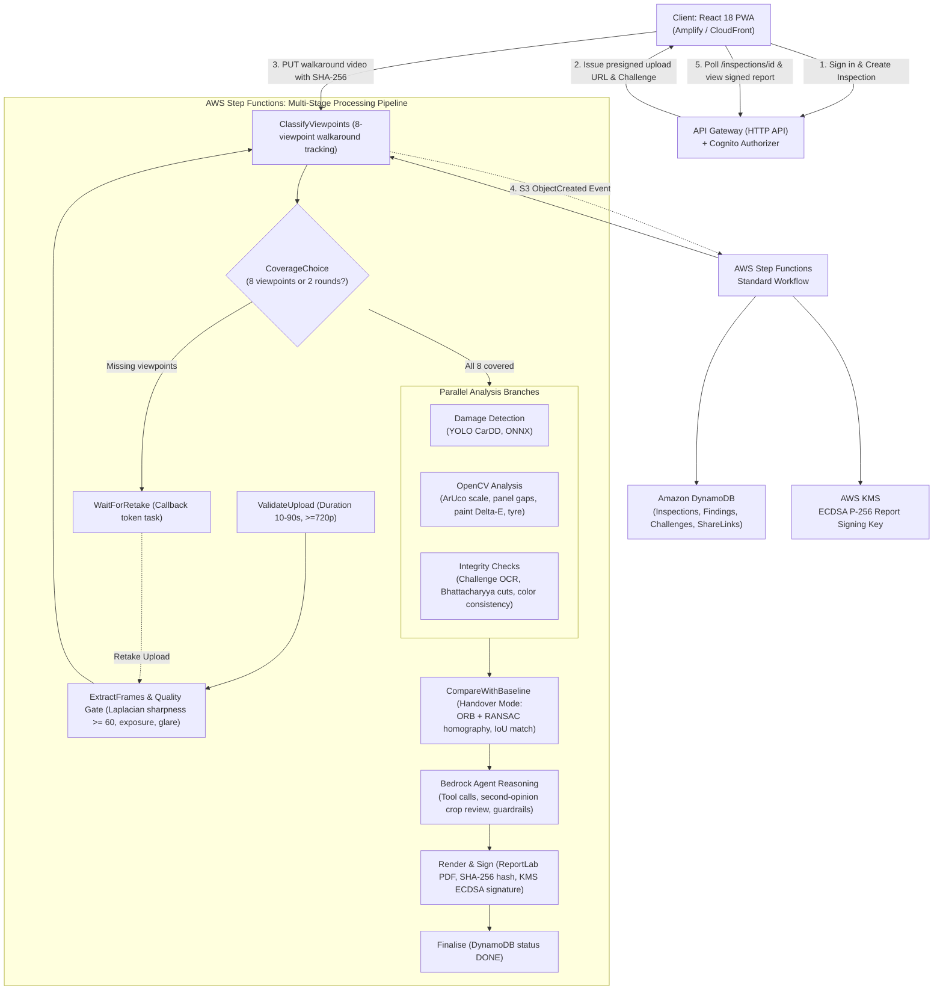

# CarCheck Agent (v1.1)

> **Evidence-backed, confidence-rated used car screening and handover inspection platform powered by OpenCV, damage detection, and agentic AI vision.**

[](https://www.python.org/)
[](https://react.dev/)
[](https://aws.amazon.com/cdk/)
[](LICENSE)
[](http://15.207.101.82)

🔗 **Live AWS Public Demo**:  [http://ec2-15-207-101-82.ap-south-1.compute.amazonaws.com](https://15-252-9-51.sslip.io)*

---

## 🌟 Overview & Core Differentiators

CarCheck Agent transforms a smartphone walkaround video of a vehicle into an explainable, tamper-evident condition report within 60 seconds. It combines deterministic computer vision measurements (OpenCV) with an agentic AI reasoning layer (Amazon Bedrock Agent) and strict grounding guardrails.

### 1. 🔄 Handover Mode (FR19 – FR22)
Designed for rental companies, car-sharing fleets, and private buyers re-inspecting vehicles after repair:
- **Baseline vs. Return Comparison**: Pairs matching viewpoints across inspections.
- **Geometric Registration**: ORB feature extraction (2,000 features), KNN ratio test (0.75), and RANSAC homography estimation with strict inlier filtering ($\ge 40$ inliers, $\ge 40\%$ inlier ratio).
- **Detector-Level Coordinate Transformation**: Maps return bounding boxes to baseline frame space via `cv2.perspectiveTransform` and matches detections by IoU ($\ge 0.3$).
- **Unambiguous Categorization**:
  - `NEW`: Damage detected on return not present in pickup baseline.
  - `PRE-EXISTING`: Verified present on the vehicle at baseline pickup.
  - `RESOLVED`: Detected at baseline but no longer present (repaired/buffed).
  - `UNCERTAIN`: Alignment failed or lighting conditions prevented reliable comparison.
- **Side-by-Side Visual Proof**: Baseline and return evidence crops presented side-by-side for rapid dispute resolution.

### 2. 🛡️ Trust Layer (FR23 – FR26)
Defends against fake walkarounds, pre-recorded videos, spliced footage, and forged reports:
- **Single-Use Capture Challenge (FR23)**: Server generates a 4-digit nonce and random angle sequence (expires in 10 minutes, single use). The seller must show the code in-frame during capture.
- **In-App Capture Stream**: Rejects pre-recorded gallery uploads in trust mode.
- **Client Video SHA-256 (FR24)**: Computed in the browser using the WebCrypto API (`crypto.subtle.digest`) and verified upon upload.
- **Continuity & Hard Cut Detection (FR25)**: Evaluates Bhattacharyya distance across normalized grayscale histograms of consecutive frames ($d > 0.5$ flags hard cuts/splices).
- **Appearance & Plate Consistency**: Monitors vehicle body color $\Delta E$ in CIELAB and license plate persistence across angles.
- **ECDSA P-256 Digital Signature (FR26)**: The canonical report JSON digest is signed with an asymmetric `ECC_NIST_P256` key (AWS KMS / local cryptography).
- **Public Verify Endpoint**: `/reports/{id}/verify` recomputes the report digest and verifies the digital signature for complete public auditability.

---

## 🏛️ System Architecture



---

## 🔌 Ports and Adapters (Hexagonal Architecture)

The system is decoupled into domain interfaces (ports) with interchangeable AWS and local adapters:

| Port | Local Adapter (One-Command Run) | AWS Cloud Adapter (`cdk deploy`) |
| :--- | :--- | :--- |
| **StoragePort** | `LocalStorageAdapter` (`data/` directory) | `S3StorageAdapter` (S3 + SSE-KMS + lifecycle) |
| **DbPort** | `LocalDbAdapter` (SQLite with JSON support) | `DynamoDbAdapter` (Amazon DynamoDB on-demand) |
| **AuthPort** | `LocalAuthAdapter` (HMAC-SHA256 JWT) | `CognitoAuthAdapter` (Cognito User Pool JWTs) |
| **DetectorPort** | `LocalDamageDetector` (CarDD ONNX Runtime + OpenCV fallback) | `SageMakerDetectorAdapter` / ONNX Lambda |
| **AgentPort** | `LocalBedrockAgentAdapter` (7 tool schemas + guardrails) | `BedrockAgentAdapter` (AWS Bedrock Agent Runtime) |
| **SigningPort** | `LocalEcdsaSigningAdapter` (ECDSA P-256 SECP256R1) | `KmsSigningAdapter` (AWS KMS `ECC_NIST_P256`) |
| **WorkflowPort** | `LocalWorkflowRunner` (Async Python state machine) | `StepFunctionsWorkflowAdapter` (Step Functions) |

---

## 🧠 Machine Learning & Damage Detection (CarDD YOLOv8 + ONNX)

While classical OpenCV handles geometric and photometric measurements (ArUco / plate millimeter scale, panel gaps, and CIEDE2000 paint mismatches), visual surface damage detection is powered by a fine-tuned deep learning model:
- **Taxonomy**: 6 CarDD (Car Damage Dataset) classes: `dent`, `scratch`, `crack`, `glass_shatter`, `lamp_broken`, `tyre_flat`.
- **Serving Engine**: Quantized ONNX model running inside `onnxruntime` CPU session with 4 intra-op threads (<200ms cold start, sub-50MB runtime layer, zero PyTorch footprint in Lambda).
- **TRD 7 Severity Banding**: Damage severity is deterministically calculated by measuring bounding box area relative to panel area:
  - **Minor**: Area ratio < 2%
  - **Moderate**: Area ratio between 2% and 8%
  - **Major**: Area ratio > 8%
- **Tools & Scripts**:
  - `python ml/dataset_prep.py` — CarDD dataset download and YOLO format parser.
  - `python ml/train_cardd.py` — YOLOv8 fine-tuning with phone walkaround augmentations.
  - `python ml/export_onnx.py` — Checkpoint to ONNX export with pinned IR version 10.
  - `python -m ml.onnx_inference` — Standalone ONNX inference engine.
  - `python ml/notebook_walkthrough.py` — Interactive visual notebook walkthrough.

---

## ⚡ Deliverable 1: One-Command Local Run (No AWS Credentials)

Run the entire full-stack application locally with a single command:

```bash
# Option A: Python runner
python run_local.py

# Option B: PowerShell
./start-local.ps1

# Option C: Windows Batch
run_local.bat
```

### What happens automatically:
1. Local SQLite database (`data/carcheck.db`) and storage folders are initialized.
2. ECDSA P-256 cryptographic keypair is generated/loaded.
3. Pre-populated demo inspections are seeded:
   - **Baseline Inspection**: 2026 Toyota CH-R (Score 86/100, Trust `VERIFIED`, signed report PDF ready).
   - **Return Handover Inspection**: 2026 Toyota CH-R (Score 82/100, Handover Mode displaying 1 `NEW` scratch and 1 `PRE-EXISTING` dent, signed report PDF ready).
4. FastAPI server starts on `http://localhost:8000`, simultaneously serving the REST API and the React 18 PWA frontend!
5. Open `http://localhost:8000` in any web browser to explore:
   - Guided 360 walkaround capture with real-time camera and car ghost wireframe
   - Glare warnings and single-use challenge code
   - Handover Mode comparison with side-by-side evidence crops
   - Tamper-evident condition report with PDF download
   - Public verify page validating the ECDSA digital signature and SHA-256 hash.

---

## 🚀 Deliverable 2: One-Command AWS Deploy

Deploy the complete serverless architecture to your AWS account using AWS CDK:

```bash
cd infra
pip install -r requirements.txt
cdk synth
cdk deploy --all
```

### Stacks Deployed:
- `CarCheckStorageStack`: Private S3 bucket (SSE-KMS, 1-day raw video lifecycle, 7-day frames lifecycle), DynamoDB on-demand tables (`Inspections`, `Findings`, `Captures`, `Challenges`, `ShareLinks`), and KMS `ECC_NIST_P256` asymmetric report signing key.
- `CarCheckAuthStack`: Amazon Cognito User Pool with email sign-in and JWT authorization.
- `CarCheckAgentStack`: Amazon Bedrock Agent with Action Groups and grounding guardrails.
- `CarCheckWorkflowStack`: AWS Step Functions Standard State Machine with parallel analysis branches, retake wait token, and DLQ.
- `CarCheckApiStack`: Amazon API Gateway (HTTP API) with Cognito JWT authorizer, API Lambdas, and public verify endpoint.
- `CarCheckObservabilityStack`: CloudWatch log groups, p95 latency alarm (>90s), failure rate alarm, and X-Ray tracing.

---

## 🧪 Deliverable 3: Automated Tests

### 1. Unit Tests (Computer Vision & Security)
Tests Laplacian sharpness, exposure clipping, glare HSV ratio, viewpoint tracking, panel gap Hough lines, CIEDE2000 paint mismatch, Bhattacharyya cuts, IoU matching, condition scoring, ECDSA P-256 signing, and JWT auth:

```bash
python -m pytest tests/test_unit_cv.py tests/test_unit_security.py -v
```

### 2. Integration Tests (End-to-End API Lifecycle)
Tests full inspection lifecycle: creation, challenge issuance, upload, asynchronous Step Functions workflow execution, retake loop, condition report retrieval, PDF download, public verification, share link generation, and inspection deletion:

```bash
python -m pytest tests/test_integration_api.py -v
```

### 3. Playwright Browser E2E Tests
Runs automated browser testing of the React PWA user journeys:

```bash
python -m pytest tests/test_e2e_playwright.py -v
```

---

## 📋 REST API Reference (TRD Section 9)

| Method | Path | Auth | Description |
| :--- | :--- | :--- | :--- |
| `POST` | `/inspections` | JWT | Creates an inspection; returns ID, upload URL, and challenge code |
| `POST` | `/inspections/{id}/start` | JWT | Starts asynchronous Step Functions processing workflow |
| `GET` | `/inspections` | JWT | Lists authenticated user's inspections |
| `GET` | `/inspections/{id}` | JWT | Retrieves inspection state, retake list, and report (when DONE) |
| `POST` | `/inspections/{id}/retake` | JWT | Submits retake frames and resumes workflow |
| `GET` | `/inspections/{id}/report.pdf`| JWT / Link | Downloads signed condition report PDF |
| `POST` | `/inspections/{id}/share` | JWT | Generates read-only public share link with TTL |
| `GET` | `/share/{token}` | None | Public read-only report view |
| `GET` | `/inspections/{id}/challenge` | JWT | Retrieves single-use capture challenge (nonce & angle order) |
| `POST`| `/inspections/{id}/challenge/verify` | JWT | Verifies challenge code |
| `GET` | `/inspections/{id}/comparison` | JWT | Retrieves Handover comparison diff against baseline |
| `GET` | `/reports/{id}/verify` | None | Public verification endpoint: validates report hash & signature |
| `DELETE`| `/inspections/{id}` | JWT | Deletes inspection record and removes all media |

---

## ⚖️ Hard Rules & Grounding Guardrails

- **Screening Tool Only**: CarCheck Agent is strictly a visual screening tool. It **never** claims a vehicle is "accident-free" or certified. Every report and verification page prominently displays the screening disclaimer.
- **Deterministic Condition Score**: Scores are calculated strictly by mathematical formula ($100 - \sum \text{penalties}$) with defined category caps (Body damage: max 30, Gap asymmetry: max 20, Paint mismatch: max 20, Tyres: max 15, Glass: max 15). The LLM never invents scores or measurements.
- **Evidence-Linked Claims**: Every statement and question in the report must cite a specific finding ID backed by an annotated crop. Free-text claims without evidence references are rejected by schema validation.
